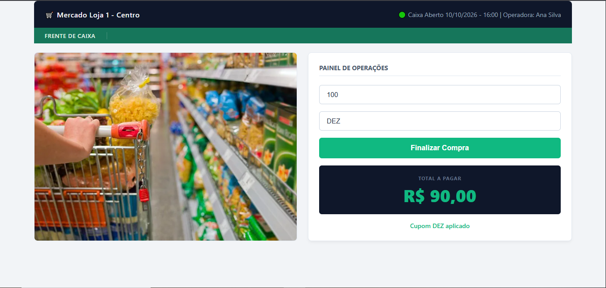

# 🛒 Sistema de Caixa de Supermercado

## 📸 Demonstração do sistema

Aplicação web desenvolvida com **HTML5, CSS3 e JavaScript**, com foco na implementação de regras de negócio, validação de valores e aplicação de cupom de desconto em uma simulação de compra.

## 📌 Sobre o projeto

Este projeto faz parte do meu portfólio de desenvolvimento e tem como objetivo aplicar conceitos de lógica de programação e desenvolvimento front-end em uma situação prática relacionada ao caixa de supermercado.

A aplicação utiliza JavaScript para capturar os dados informados pelo usuário, validar o valor do produto e calcular o preço final conforme a regra de desconto definida.

## 🚀 Tecnologias utilizadas

- **HTML5:** estrutura dos elementos da interface.
- **CSS3:** estilização e apresentação visual.
- **JavaScript:** manipulação do DOM, tratamento de eventos, validação de entradas e implementação das regras de negócio.

## ⚙️ Funcionalidades implementadas

- **Validação do valor do produto:** impede o processamento quando o campo está vazio ou o valor informado é zero.
- **Limite de valor:** exibe uma mensagem de erro quando o valor informado ultrapassa R$ 10.000.
- **Cupom de desconto:** reconhece o cupom `DEZ` e aplica um desconto fixo de R$ 10,00.
- **Cálculo do preço final:** apresenta o valor com desconto quando o cupom é válido ou o preço informado quando não há cupom válido.
- **Mensagens de feedback:** informa erros e resultados na interface.
- **Manipulação do DOM:** atualiza o conteúdo e a cor do texto de resultado dinamicamente.
- **Evento de clique:** executa as regras de negócio ao clicar no botão de finalização da compra.

## 🧠 Conceitos praticados

- Declaração de variáveis com `const` e `let`.
- Seleção de elementos HTML com `document.getElementById()`.
- Manipulação de propriedades e conteúdo de elementos.
- Tratamento de eventos com `addEventListener()`.
- Estruturas condicionais com `if` e `else`.
- Validação de entradas e cláusulas de guarda.
- Conversão de valores com o operador unário `+`.
- Manipulação de strings com `trim()`.
- Implementação de regras de negócio.

## 💻 Como executar o projeto

1. Clone este repositório ou faça o download dos arquivos.
2. Abra a pasta do projeto no Visual Studio Code.
3. Abra o arquivo HTML principal no navegador.
4. Informe um valor para o produto.
5. Para testar o desconto, digite `DEZ` no campo do cupom.
6. Clique no botão de finalizar a compra e observe o resultado.

O HTML deve conter os elementos com os IDs `valor-produto`, `cupom-desconto`, `finalizar-compra` e `preco-final`, utilizados pelo JavaScript.

## 🧪 Exemplos de testes manuais

| Cenário | Entrada | Resultado esperado |
|---|---|---|
| Valor vazio | Campo de valor em branco | Mensagem de valor inválido |
| Valor zero | `0` | Mensagem de valor inválido |
| Valor acima do limite | `10001` | Mensagem de valor acima do permitido |
| Cupom válido | `100` e `DEZ` | Resultado de R$ 90,00 |
| Cupom inválido | `100` e `ABC` | Resultado de R$ 100,00 |
| Sem cupom | `100` e campo vazio | Resultado de R$ 100,00 |

## 👩‍💻 Autora

**Veronica Batista**

Estudante de Gestão da Tecnologia da Informação, com interesse em desenvolvimento de software e aprimoramento contínuo das habilidades técnicas.

- **GitHub:** [veronicaskills-cmyk](https://github.com/veronicaskills-cmyk)
- **Repositório:** [Sistema de Caixa de Supermercado](https://github.com/veronicaskills-cmyk/sistema-supermercado)

---

*Projeto desenvolvido para fins de aprendizagem e construção de portfólio profissional.*
